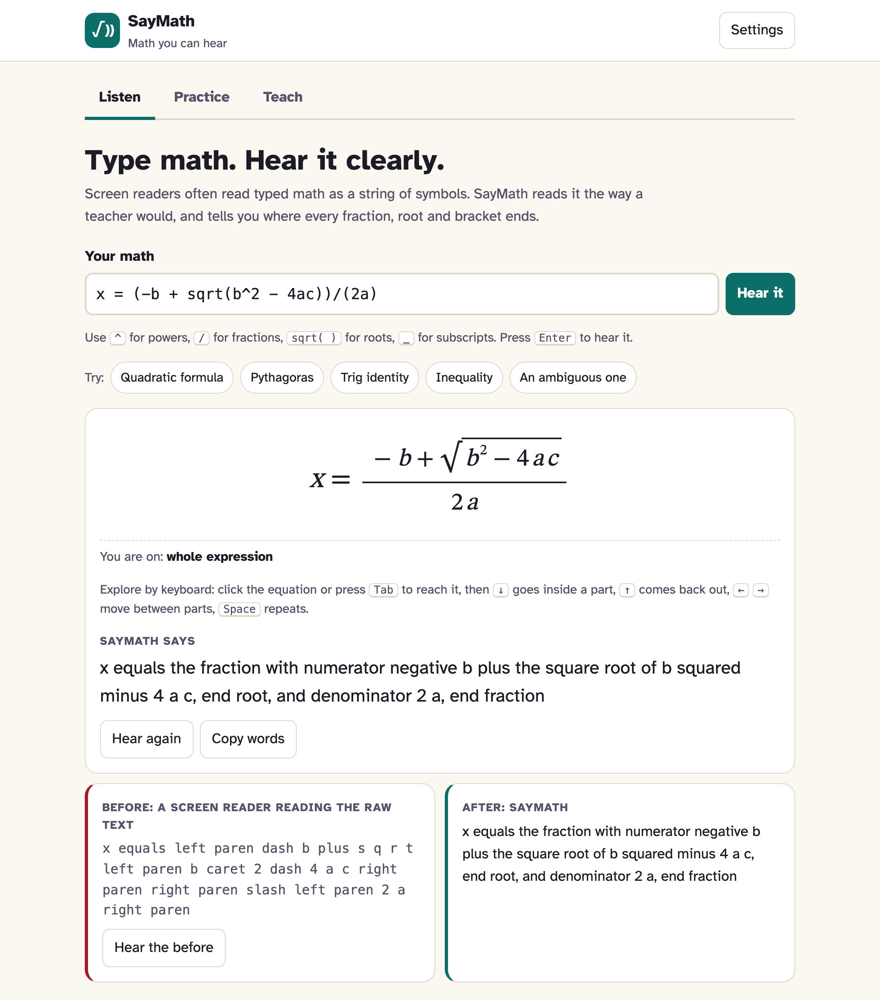
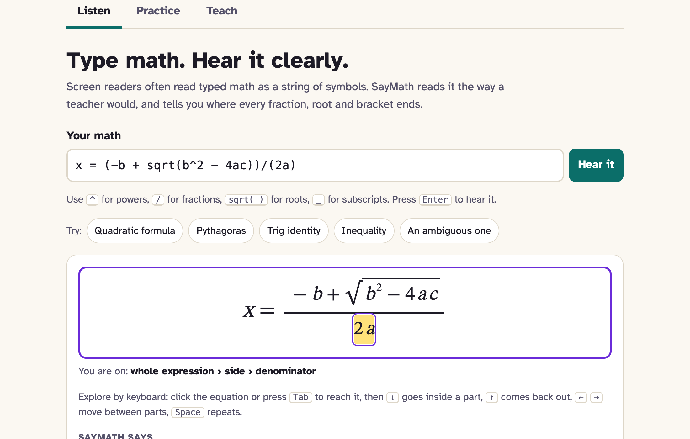

# SayMath

**Math you can hear.** SayMath turns typed equations into clear, unambiguous speech in English and Hindi. Learners can explore an equation piece by piece with the arrow keys, practise by ear with answers checked, and teachers can make offline worksheets that fit in a WhatsApp message.

**Live demo:** https://shineyrbl-byte.github.io/saymath/ (no sign-up, no install, works offline after the first visit)

**Demo video (2.5 min, captioned):** https://youtu.be/OQ8i_HQ8HNc · transcript: [docs/DEMO.md](docs/DEMO.md)

Built for **AccessED Hacks** (October 17 – November 20, 2026). Everything in this repository was written during the event: there is no pre-existing foundation.



## The barrier

A blind or low-vision student gets maths homework as a PDF, a WhatsApp message or a web page. The equation is either an image (silent to a screen reader) or typed text like `x = (-b + sqrt(b^2 - 4ac))/(2a)`. A screen reader reads that typed text symbol by symbol:

> **Before:** "x equals left paren dash b plus s q r t left paren b caret 2 dash 4 a c right paren right paren slash left paren 2 a right paren"

To understand it, the student has to hold every bracket in their head and rebuild the fraction from the symbols. Sighted classmates see it in one glance. Worse, the same words can mean different things: "square root of x plus 1" could be √x + 1 or √(x + 1).

> **After (SayMath):** "x equals the fraction with numerator negative b plus the square root of b squared minus 4 a c, end root, and denominator 2 a, end fraction"

And then they can explore it: press ↓ to go into the fraction, → to jump to the denominator ("denominator: 2 a"), ↑ to come back out.

The same barrier is doubled for students in Hindi-medium schools, where maths is taught and spoken in Hindi but every tool reads it in English.

### Who it's for

- **Blind and low-vision students** who use screen readers or listen to text, from middle school to early college maths
- **Students with dyslexia** or reading difficulties who understand maths better by hearing it, with highlighting
- **Hindi-medium learners**, who can hear the same maths in Hindi word order
- **Teachers** (especially in schools with no specialist support) who need to send accessible maths to one student without special software

*Example learner (made-up, a composite):* Meera is in Class 9 at a Hindi-medium school. She is blind and uses a screen reader on a shared family laptop and an old Android phone with patchy data. Her teacher sends algebra homework on WhatsApp. Today she asks her brother to read it out. With SayMath, her teacher sends one 53 KB file. Meera opens it with no data, hears each question in Hindi, explores the fraction with the arrow keys, types her answer and hears "सही!" (correct).

## What it does

| | |
|---|---|
| **Listen** | Type or paste math. SayMath shows it as a real equation and reads it aloud with clear rules (below). A side-by-side *before/after* shows what a screen reader says for the raw text. |
| **Explore** | Arrow keys walk the equation like a tree: ↓ into a part, ↑ back out, ← → between parts, Home for the whole thing, Space to repeat. Each step says its role ("numerator", "term 2 of 3"). Sighted users see the part highlighted and a breadcrumb ("whole expression › side › denominator"). |
| **Practice** | 13 practice problems in 3 sets (equations; fractions, powers and roots; simplifying). Hear the problem, explore it, type an answer. **SayMath reads your answer back as you type** ("SayMath hears: x equals 5"), so you know it understood you. Answers are checked by value: `8/2`, `x = 4` and `4` all count; for simplifying, any equivalent expression counts. Hints in both languages. |
| **Teach** | A teacher types one question per line (`Solve for x: 3x - 4 = 11 answer: x = 5`). SayMath previews every line as speech and **flags anything a listener could misunderstand**, like `1/2x`. One click downloads a **single 53 KB HTML file** with the whole engine inside: speech, explorer, Hindi and answer checking, with no internet needed. Or copy the questions as plain words for SMS or a braille display. |
| **Hindi** | Every spoken pattern has a Hindi version that follows Hindi word order: एक्स का वर्ग, ए बटा बी, एक्स, 5 से कम है. |
| **Offline** | After the first visit the app works with no signal and can be installed to the home screen. |
| **Readable** | Atkinson Hyperlegible font (designed for low vision), large / extra-large text, light, dark and high-contrast (yellow on black) themes, 44px touch targets. |



## How SayMath decides what to say

The main rule: **anything that groups says where it ends**, unless it only holds a single number or letter.

| You type | SayMath says | Why |
|---|---|---|
| `sqrt(x+1)` | the square root of x plus 1, **end root** | Different from √x + 1 |
| `sqrt(x)+1` | the square root of x plus 1 | Root holds one letter: no end needed |
| `x^n + 1` | x to the **n-th power** plus 1 | "power" closes the exponent |
| `x^(n+1)` | x to the power n plus 1, **end power** | |
| `(a+b)^2` | the quantity a plus b, end quantity, squared | |
| `sin^2 x` | sine squared of x | Never "sine of x squared" (that is sin(x²)) |
| `1/2 + 3/4` | one half plus three quarters | Natural names for simple fractions |
| `2(x+1)` | 2 **times** the quantity x plus 1, end quantity | "times" before brackets |
| `1/2x` | ⚠️ *Warning: could mean (1/2)·x or 1/(2x)* | Ambiguous input is flagged, not guessed silently |

In Hindi: `x^n + 1` → "एक्स की एन घात प्लस 1" and `x^(n+1)` → "एक्स की घात एन प्लस 1, घात समाप्त".

A **Brief** mode drops the end marker only at the very end of an expression, where it can't be ambiguous.

Input supports `^ / * _ ! | ( ) [ ]`, `sqrt()`, `root(3, x)`, `abs()`, `sin cos tan log ln`, `log_2(8)`, `pi theta alpha…`, `<= >= !=`, and Unicode (`x² √ ≤ ÷ π`).

## Try it in 2 minutes (for judges)

1. Open the [live demo](https://shineyrbl-byte.github.io/saymath/). Press **Quadratic formula**. Press **Hear the before**, then **Hear again**. That is the before and after.
2. Click the equation (or Tab to it) and use ↓ → ↑ to walk into the fraction.
3. Press **An ambiguous one** to see the warning.
4. Open **Practice**. Type `x = 5` and press Check (wrong, with your answer read back). Press **Hint**, then type `8/2` (accepted: it's 4).
5. Open **Settings → Language → हिन्दी** and hear the same problem in Hindi.
6. Open **Teach** and press **Download worksheet**. Turn off Wi-Fi and open the file: it still reads, explores and checks answers.

For the full experience, turn on a screen reader (VoiceOver: Cmd+F5 on Mac; NVDA on Windows) and set **Settings → Speak with this device's voice** off, so you only hear the screen reader.

## Run it locally

No build step and no dependencies. You need Node 20+ (or any static file server, such as `python3 -m http.server`).

```bash
git clone https://github.com/shineyrbl-byte/saymath.git
cd saymath
npm start                         # small built-in server, no installs
# open http://localhost:8080
```

Tests (Node 20+; browser tests need Google Chrome):

```bash
npm test                          # 27 unit tests: parser, speech, Hindi, answer checking, worksheet bundler
node scripts/serve.mjs 8765 &     # browser tests expect the site here
npm run test:browser              # 46 checks in headless Chrome with real key presses
```

## Testing evidence

Automated, run on every push by GitHub Actions:

- **Keyboard:** real arrow-key presses walk the quadratic formula and check every announcement, edge message and breadcrumb; Tab order; the ARIA tabs pattern.
- **Practice:** wrong answers get read back, hints are spoken, `8/2` is accepted for `x = 4`, focus moves to Next, Hindi prompts.
- **Worksheet file:** opened as its own page, **0 external requests**, answer checking and explorer work inside it, fits a phone.
- **Offline:** the app reloads with the network cut off; settings are remembered.
- **Phone width:** no sideways scrolling at 390px on any tab or in the worksheet.
- **Accessibility audit:** [axe-core](https://github.com/dequelabs/axe-core) on every tab in light, dark and high-contrast themes: **0 violations** in all 9 runs.
- **Content:** every built-in answer key is checked to satisfy its equation.

Manual:

- **VoiceOver on macOS:** I tested the app myself with VoiceOver and the app's own voice turned off. VoiceOver read the equation, the arrow keys walked into the fraction and announced each part ("numerator", "denominator: 2 a"), and Practice read back my answer and the feedback. Everything worked as designed.

Not yet done (and important): **testing with blind and low-vision students and with Hindi-medium maths teachers.** My own VoiceOver test shows the app works with a screen reader, but I'm not a daily screen reader user. Only real learners can show whether the design is right for them. This is the next step.

## Limitations

- **Typed input only.** SayMath can't read equations inside images or PDFs yet. A teacher or student has to type them (or paste typed text).
- **Hindi wording is a first version.** It follows common classroom usage, but it hasn't been reviewed by Hindi-medium maths teachers. The buttons and labels are still in English. Only the spoken maths, prompts and feedback are in Hindi.
- **Voices depend on the device.** Speech uses the browser's built-in voice. Some devices have no Hindi voice, and the app says so. Screen reader users can turn the built-in voice off and hear everything through their screen reader instead.
- **Screen readers: tested only with VoiceOver on macOS.** The explorer uses `role="application"` and a live region, and works with keyboard only. NVDA, JAWS and TalkBack haven't been tested yet and may behave differently.
- **School-level maths only:** no matrices, integrals, sums or calculus notation yet.
- **Answer checking compares values**, not working: it can't give credit for method, and it can't check proofs.
- **No braille output** beyond copying plain words to a braille display (no Nemeth or Bharati braille maths code).

## How it's built

Plain JavaScript ES modules, no framework, no build step, no server, no API keys. Nothing the learner types leaves their device.

```
src/parser.js        typed math → tree (implicit multiplication, Unicode, friendly errors, ambiguity warnings)
src/speak.js         tree → words, with the "say where groups end" rule; language-independent
src/lang/en.js       English phrasebook
src/lang/hi.js       Hindi phrasebook (Hindi word order)
src/render.js        tree → HTML equation, one element per part
src/explorer.js      arrow-key explorer
src/evaluate.js      evaluates trees; checks answers by value at several points
src/practice.js      Practice tab
src/worksheet.js     worksheet parsing + a tiny bundler that inlines the engine into one HTML file
src/worksheet-runtime.js  the code that runs inside a downloaded worksheet
sw.js                offline cache
tests/               unit tests (node:test) and browser tests (Chrome DevTools Protocol, no dependencies)
```

## Credits and disclosure

- **AI assistance:** built with help from Claude Code (Anthropic), which was used for planning, writing code and tests, and drafting this README. I reviewed, ran and tested everything.
- **Font:** [Atkinson Hyperlegible](https://brailleinstitute.org/freefont) by the Braille Institute (SIL Open Font License), loaded from Google Fonts. If it can't load, the app falls back to system fonts.
- **Testing only:** [axe-core](https://github.com/dequelabs/axe-core) (MPL-2.0), loaded from cdnjs during the accessibility audit. It is not part of the app.
- **Data:** no datasets. All practice problems, worksheet examples and the learner example are made up. No real student data is used anywhere.
- **Inspiration:** the idea of speaking where groups end follows the approach of MathSpeak-style rules used in accessible maths. All code and wording here are original.
- **Pre-existing work:** none.

## License

MIT
